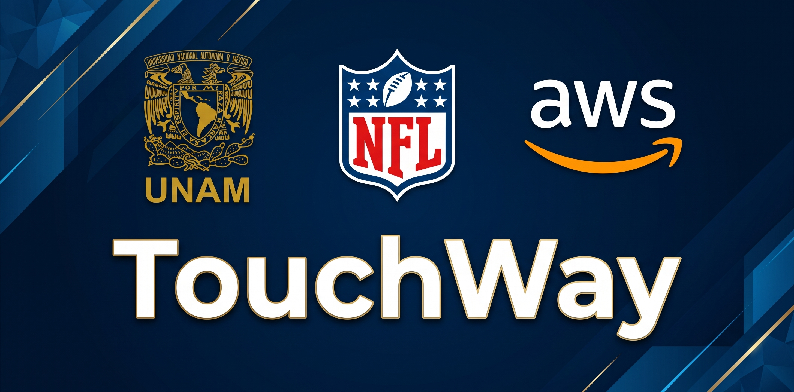
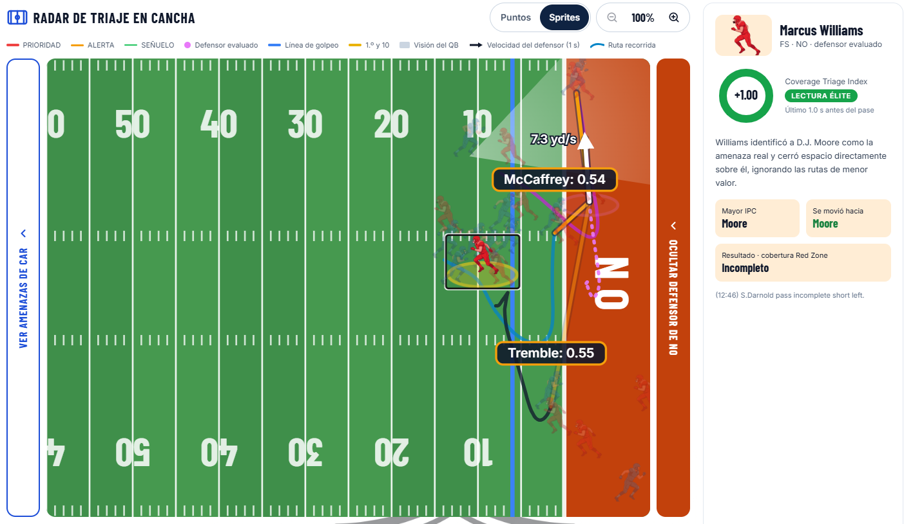

# TouchWay

TouchWay es un radar para entrenadores defensivos que muestra, en cada jugada de pase de la NFL, si el defensor persiguió al receptor más peligroso o mordió un señuelo. Con el tracking del Big Data Bowl 2023 (10 cuadros por segundo), calcula en cada cuadro la prioridad de cada receptor (IPC): qué tan solo está, si el QB lo está mirando y qué tan cerca está del primer down. Luego mide si el defensor corrió hacia la amenaza real en el último segundo antes del pase (CTI, de −1 a +1): cuando lee bien, la ofensiva completa 49.8% de sus pases; cuando muerde el señuelo, 69.0%. Para verlo, arranca el backend (`.venv\Scripts\python -m uvicorn backend.main:app`) y el dashboard (`cd dashboard && npm run dev`), abre la página y toca **Tutorial** en el encabezado.

Hecho en ENES Juriquilla (UNAM) por **Jaime Silva C.** y **Miguel Angel R.** · Datos: NFL Big Data Bowl 2023 · Fotos: ESPN / NFL.com vía nflverse.
